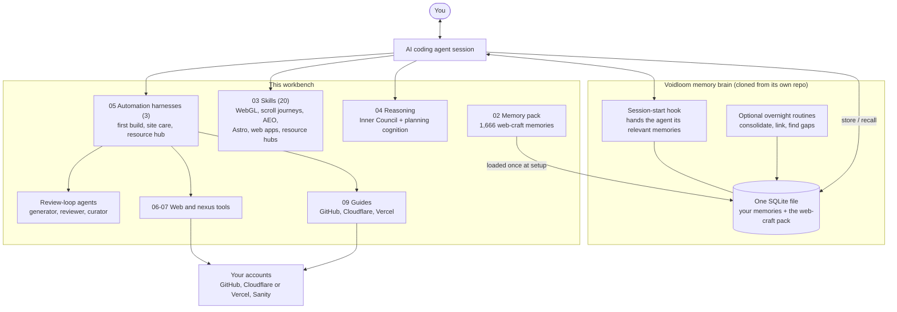
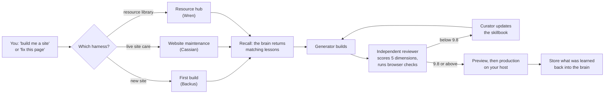
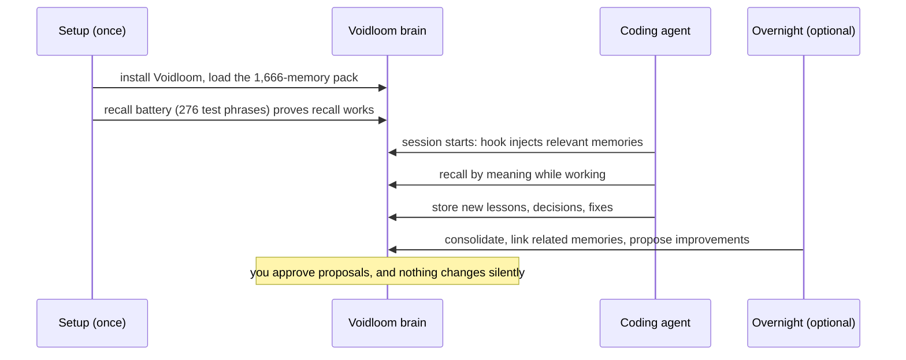

# Voidwright's webdev workbench

**An AI-native website, built and run from your favorite LLM.**

Most websites are built for people to click through. AI usually arrives afterwards: bolted on through plugins and
admin panels, or reading from the outside a site that was built for humans. Voidwright's webdev workbench turns that around. The AI builds the whole
site with itself at the center, so it holds every lever: the code, the pages, the content, the deploys and the
infrastructure. You build, change, redesign and grow the site by talking to it in the terminal. The AI carries out
the work as the site's own operator.

**Every site is built on [Astro](https://astro.build),** the modern static-first web framework. That choice is what
makes AI control practical: every page, component, style token and route is plain code in a git repository, which the
AI can read, change, test and deploy, with no database-driven admin screen standing between it and the site. Pages
ship as fast static HTML, and content can come from a headless content store when the site needs one.

It runs through whichever **AI coding agent** you already use: Claude Code, Codex, Antigravity, Kimi Code, or a local model run through a tool such as Ollama. Setup installs [Voidloom](https://github.com/void-wright/voidloom), a local memory brain for
AI agents, and loads it with **1,666 memories of web craft**. On top of that sit **18 skills**, **three website
automation harnesses** that grade every build with an independent reviewer, a set of **reasoning aids**, small **web tools**,
and **plain step-by-step guides** for GitHub, Cloudflare and Vercel.

Your agent does the setup itself. You start it in this folder (or start it anywhere and point it at the folder), say
one sentence, answer one round of questions, and do the few steps that are yours alone: passwords, browser sign-ins and
spending limits.

[](./LICENSE)
[](https://github.com/void-wright/voidloom)

---

## The idea: AI at the center

A conventional site gives an AI assistant a narrow window: paste this into the editor, click that in the dashboard.
Putting the AI at the center instead leads to seven working principles.

- **The AI is the operator.** Every part of the site is something it can read and change from the terminal: Astro
  pages and components, design tokens, the content store, the deploy pipeline, DNS and security headers. The few
  steps that genuinely need a person, such as a sign-in or a spending limit, are named and handed to you.
- **The site is modular, so it can grow.** Pages are built from components, styles from tokens, and resources from
  structured records in a headless content store. The AI finds the one piece to change, changes it, and leaves the
  rest alone.
- **Content goes live from the console.** Approved pages, posts and resources are assembled, deployed to a preview,
  checked in a real browser and promoted to production in one continuous run, without a manual upload step.
- **The site is written for other AIs to read.** Answer-engine optimization, structured data and agent-readable files
  such as `llms.txt` are part of the build, so AI search and AI agents can find, quote and use the site.
- **Nothing ships unreviewed.** Each automation harness runs a generator, an independent reviewer and a curator. A build is
  done only when it clears a hard threshold of 9.8 out of 10.
- **It remembers.** The memory brain recalls past fixes, decisions and preferences by meaning at the start of every
  session, so a lesson learned on one page is applied on the next.
- **It stays on your side.** The brain is one file in your home folder. Keys live in your own key file, never in a
  repository or a chat. **No keys are required at all:** every paid service has a manual route where the agent writes the
  settings into a handoff file and you complete the step on the vendor's website.

### What piloting a site looks like

You describe the change. The AI recalls what it knows, does the work, checks it and reports back.

- "Add a page for the autumn menu, link it from the navigation, and show me the preview."
- "The contact form stopped sending. Find out why and fix it."
- "Turn these notes into this week's post, add the images, and publish it once I approve the preview."
- "Make the site easier for AI search engines to cite."

---

## How it fits together



**The memory brain** is Voidloom: a command-line tool, a session-start hook and one SQLite file. Setup clones it from
its public repository at a pinned commit and installs it. It is not copied into this repo.

**The skills** are knowledge the agent reaches for while it works. **The automation harnesses** wrap the model for whole jobs:
each one gives it a persona, a step-by-step guide, a skillbook of hard-won rules, a memory map and a review loop, so a
complete job runs from start to finish. **The reasoning aids** help with weighty decisions.
**The tools and guides** are what the harnesses use to reach your own accounts.

### What happens on a site job



The three harnesses hand work to each other: the first build registers every new site so the maintenance
harnesses can find it later.

### The memory lifecycle



---

## What is inside

| Folder | What it holds |
|---|---|
| `00_START_HERE.md` | The two-minute overview for the person installing it |
| `SETUP_GUIDE.md` | The guide the agent follows to install everything, phase by phase (P0 to P8) |
| `02_memory/` | The web-craft memory pack, its manifest and the recall battery |
| `03_skills/` | 18 skills (listed below) |
| `04_reasoning/` | The four Inner Council voices, the planning-cognition skill and the `/inner-council` command |
| `05_automations/` | The three website automation harnesses and the three review-loop agents |
| `06_web_tools/` | Helpers for Cloudflare APIs, safe deploys, build and preview watchers, form checks |
| `07_nexus_tools/` | Keeps index memories in your brain in step with the tags they point to |
| `08_claude_md/` | The short block setup adds to your `~/.claude/CLAUDE.md` |
| `09_guides/` | Assume-nothing guides: GitHub, Cloudflare, Vercel, choosing a host, services and keys |
| `bin/` | The skill installer, a shell helper and a redaction tool for sharing logs |

### Skills

| Area | Skills |
|---|---|
| **WebGL craft** (a router plus five) | `webgl-craft` (start here), `webgl-renderer-and-budget`, `webgl-hardening-and-testing`, `webgl-interaction`, `webgl-light-and-color`, `webgl-handoff-and-porting` |
| **Pages and apps** | `astro-website-page-creation`, `web-app-building`, `prototype-website-generation`, `scroll-journey` |
| **Search and discovery** | `aeo-optimization` (answer-engine optimization), `agent-readiness-frontier` (agent-readable sites) |
| **Resource libraries** | `resource-hub-resource-page-builder`, `resource-slug-design-canonical` |
| **Design** | `corporate-graphic-design` |
| **Reasoning layers for the harnesses** | `design-architect-thinking`, `website-maintenance-thinking`, `resource-hub-thinking` |

### Automation harnesses

| Harness | Persona | Use it for |
|---|---|---|
| `client-site-first-build` | Dr. Merry Backus | A first build of a website, a resource hub or both, from a design handoff to a private preview |
| `website-maintenance` | Dr. Cassian Holt | Looking after a live site: edits, new pages, fixes, security, preview to production |
| `resource-hub-maintenance` | Dr. Wren Alcott | Running a content library on Astro and Sanity: adding, gating and organizing resources |

Each harness has a `comprehensive_guide.md`, a `skillbook.md` of hard-won rules, a `personality.json` and a memory
map that tells the agent which memories to recall at the start of a job.

### Reasoning aids

- **The Inner Council** (`/inner-council`): four voices deliberate a weighty decision in your session. Orin names
  what is known and assumed, Vael pushes back, Dessa checks how the pieces fit, and Kael-Em looks for the bolder
  option. Your own persona chairs and decides.
- **Planning cognition**: a light reasoning layer for plans, designs and critiques. It reframes the problem, names
  the real alternatives, traces second-order effects and tags assumptions.

---

## Install

**You need:** an AI coding agent (Claude Code, Codex, Antigravity, Kimi Code, or a local model run through a tool such as Ollama), git, and Python 3. It runs on Linux and macOS; on Windows, it runs inside WSL2 Ubuntu.
Plan for about **6 GB** of free disk on a Mac or a CPU-only machine (about **12 GB** with an NVIDIA GPU, **1 GB**
for the keyword-only brain), and about an hour of your attention.

```bash
git clone https://github.com/void-wright/webdev-workbench.git ~/webdev-workbench-package
cd ~/webdev-workbench-package
claude        # or codex, agy, kimi, or your local agent's command
```

Then say:

> "Read 00_START_HERE.md and SETUP_GUIDE.md, then take it from here."

The agent detects your computer and asks **everything in one message** before it installs anything: which processor the
brain may use, whether it should think overnight and with which model, how its monthly self-review is approved,
whether to run nightly routines, whether to wire the session hook, and whether to set up GitHub and a host now or
later. It then:

1. installs the prerequisites that are missing (P1);
2. clones and installs Voidloom at its pinned commit, and checks the brain works (P2);
3. loads the memory pack, adds vectors and runs the 276-phrase recall battery (P3);
4. places the skills, reasoning aids, automation harnesses and tools, after showing you a dry run (P4);
5. helps you design your own assistant persona with `/persona-forge` (P5);
6. sets up GitHub and Cloudflare or Vercel, if you asked for it (P6);
7. builds a one-page site for an invented bakery, to prove the whole chain works (P7);
8. runs a final check and shows you how to update or remove everything (P8).

Every change is recorded, and `bin/install_skills.sh --uninstall` puts back what the skill installer changed
(preview it with `--uninstall --dry-run`). Voidloom has its own uninstaller.

---

## Versions and updates

The current version is in [`VERSION`](./VERSION), and every release is listed in
[`CHANGELOG.md`](./CHANGELOG.md) and tagged in git (`v1.0.0`, and so on). To install a specific release, clone it
by tag: `git clone --branch v1.0.0 https://github.com/void-wright/webdev-workbench.git ~/webdev-workbench-package`.

To update an existing install, ask your agent to do it, or run these from the package folder:

```bash
git pull                                   # fetch the latest release
bash bin/install_skills.sh --uninstall     # remove the previous version's skills and harnesses (restores backups)
bash bin/install_skills.sh                 # install the new version
```

Then reload the memory pack exactly as in setup step P3 (`load-seed`, then the vector backfill). A newer pack replaces
changed memories in place and leaves your own memories untouched. The changelog says when a release changes the pack.

---

## Keys, accounts and the network

- **No keys are required.** Each service the skills can use has a manual route.
- **Keys you do add stay in your own key file**, `~/.config/webtools/keys.env` (readable only by you), never in a
  repository or a chat. `09_guides/SERVICES.md` explains each one.
- **The network is used** to install packages, clone Voidloom, download its models once, and reach the accounts you
  connect. Voidloom's own README lists exactly what it touches.

---

## How it was made

This workbench was distilled from real website builds, then rewritten so it carries only general craft. Before
release, every file went through automated checks for names, private paths, account identifiers, secrets and
fingerprints of the original projects. Every rewritten file was read in full by two independent readers, and two
blind reviewers each re-derived the evidence. The memory pack's recall was tested in a clean install: **273 of 276**
test phrases returned the right memory in the top five.

The two knowledge skills built from public articles (`aeo-optimization`, `corporate-graphic-design`) keep their own
synthesized guidance and a list of their sources with links. The articles themselves are not redistributed.

---

## License

[Apache-2.0](./LICENSE). See [`NOTICE`](./NOTICE) for third-party credits: the scroll-journey skill adapts an
MIT-licensed method from SenseNova, and Voidloom is installed from its own repository under its own Apache-2.0 license.

A free release by [Voidwright](https://github.com/void-wright), which builds the dependable foundations that let any
LLM stay at the center and operate local, self-contained infrastructure on its own. Built by Andrew Grainger.
